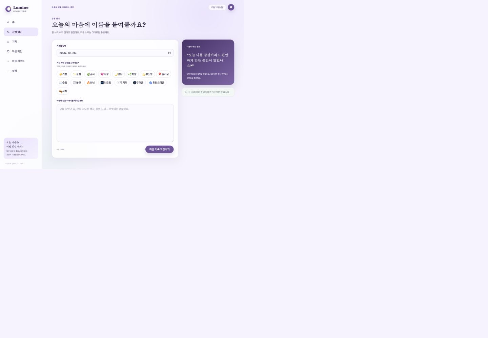
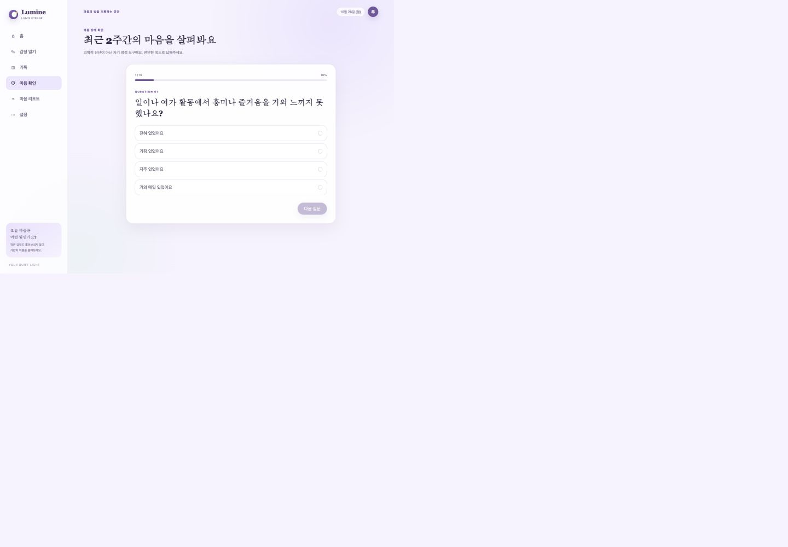
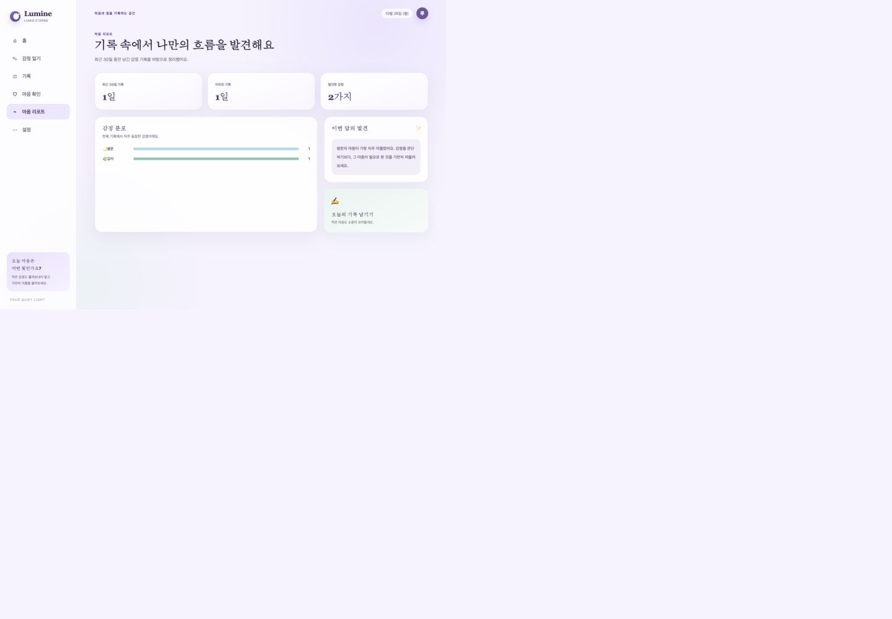
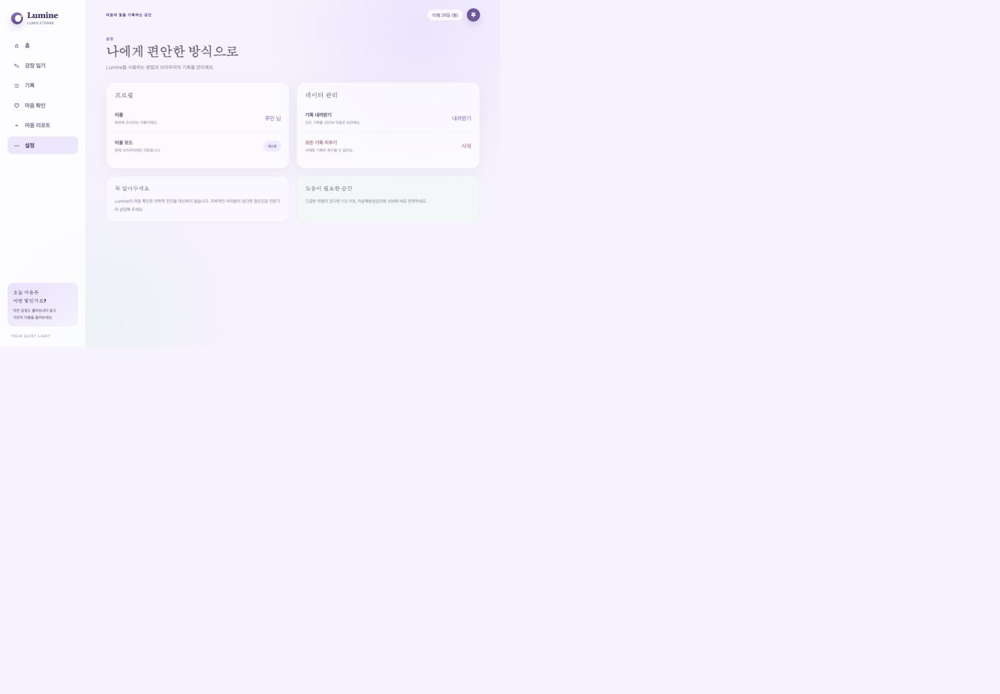
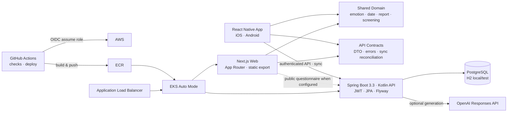

# Lumine

**Lumis Eterne — 감정을 기록하고 마음의 흐름을 돌아보는 개인 마음 기록 서비스**

Lumine은 감정이 지나간 뒤에도 사용자가 자신의 상태를 차분히 돌아볼 수 있도록 감정 일기, 비진단 목적의 마음 상태 확인, 주간·월간 리포트와 안전 도움 동선을 제공합니다. 모바일 앱과 웹은 각 플랫폼에 맞는 UI를 유지하면서, 감정·날짜·리포트 계산을 담은 Domain과 서버 DTO·동기화 규칙을 담은 API Contract를 공유합니다.

| 클라이언트                                             | 공유 계층                                   | 서버·데이터                             | 운영                                    |
| ------------------------------------------------------ | ------------------------------------------- | --------------------------------------- | --------------------------------------- |
| React Native 0.76 iOS·Android<br>Next.js 16 App Router | `@lumine/domain`<br>`@lumine/api-contracts` | Spring Boot 3.3·Kotlin<br>PostgreSQL·H2 | GitHub Actions<br>Terraform·ECR·EKS·ALB |

## 실제 실행 화면

아래 이미지는 Next.js production build를 로컬에서 실행하고, 개인 계정 없이 익명 예시 데이터로 캡처한 실제 화면입니다. 모바일 앱 캡처는 시뮬레이터가 준비된 환경에서 추가할 수 있도록 [캡처 목록과 경로](docs/images/README.md)를 정리했습니다.

| 감정 일기 작성                                                                     | 마음 상태 확인                                                                 |
| ---------------------------------------------------------------------------------- | ------------------------------------------------------------------------------ |
| [](docs/images/web-journal.jpg) | [](docs/images/web-check.jpg) |

| 기간별 리포트                                                                   | 설정·데이터 관리                                                                         |
| ------------------------------------------------------------------------------- | ---------------------------------------------------------------------------------------- |
| [](docs/images/web-report.jpg) | [](docs/images/web-settings.jpg) |

## 구현된 핵심 기능

- **감정 일기:** 16개 기본 감정과 사용자 정의 감정, 본문, 날짜별 기록, 수정·삭제, 임시 저장, 5초 삭제 취소
- **마음 상태 확인:** 단계형 문항, 비진단 안내, 안전 신호 분기, 이력 비교, 외부 생성 실패 시 규칙 기반 결과
- **리포트:** 주간·월간 기록 일수, 감정 분포, 이전 기간 비교, 대표 날짜와 다음 행동 제안
- **오프라인 안정성:** 사용자·날짜별 기기 캐시, Pending Sync 대기열, 재시도, 버전 충돌 보존
- **계정 전환:** 게스트 기록 이전 동의, 항목 단위 처리, 중복 방지 영수증, 서버 기록 우선 충돌 정책
- **데이터 주권:** JSON 내보내기, 계정·서버 데이터 삭제, 기기 캐시 정리
- **안전 지원:** 109·119·129 연락 및 도움 요청 문구 공유 동선
- **품질·운영:** 클라이언트 단위 테스트와 typecheck/lint/build, 서버 통합·보안 테스트, Terraform·Kubernetes 검증, OIDC 기반 배포

웹은 로그인 없이 브라우저 저장소에 기록하는 공개 확인 경로입니다. 네이티브 앱은 소셜 로그인, 보안 저장소, 서버 동기화와 게스트 이전까지 포함한 전체 흐름을 제공합니다. 세부 구현 범위와 제한은 [현재 기능 패치노트](docs/current-feature-patch-notes.md)에 있습니다.

## 가장 빠르게 확인하기

Node.js 22와 Corepack, pnpm 11.11.0을 사용합니다.

```bash
corepack enable
pnpm --dir client install --frozen-lockfile
pnpm run dev:web
```

브라우저에서 `http://127.0.0.1:4173`을 열면 서버나 계정 없이 감정 일기, 마음 확인, 리포트와 설정 화면을 확인할 수 있습니다. 데이터는 브라우저의 `lumine.web.v1` 저장소에만 남습니다.

| 목적                 | 명령                         | 추가 환경                                                |
| -------------------- | ---------------------------- | -------------------------------------------------------- |
| 웹만 실행            | `pnpm run dev:web`           | Node.js 22, pnpm 11.11.0                                 |
| 클라이언트 테스트만  | `pnpm --dir client run test` | 설치된 client dependencies                               |
| 클라이언트 전체 검사 | `pnpm run check:client`      | typecheck, lint, test                                    |
| 웹 production build  | `pnpm run build:web`         | 정적 export 생성                                         |
| 서버 테스트만        | `(cd server && gradle test)` | Java 17, Gradle 8.x                                      |
| 로컬 서버            | `pnpm run dev:server`        | Java 17; H2를 사용하며 Gradle 8.10.2를 `/tmp`에 준비     |
| 전체 모바일 환경     | `pnpm run dev:all`           | 서버, Metro, Xcode simulator, Android emulator 모두 필요 |
| 운영 배포            | `pnpm run deploy:all`        | AWS·Docker·kubectl·production 권한 필요; 실제 환경 변경  |

웹에서 로컬 API의 공개 마음 확인 문항을 사용하려면 `client/apps/web/.env.local`에 아래 값을 넣고 웹과 서버를 각각 실행합니다. Docker Compose는 필요하지 않습니다. 기본 서버는 인메모리 H2를 사용하고, 운영에서만 PostgreSQL profile과 Flyway migration을 사용합니다.

```dotenv
NEXT_PUBLIC_LUMINE_API_BASE_URL=http://127.0.0.1:8080
```

```bash
pnpm run dev:server
pnpm run dev:web
```

실제 Google·Kakao 로그인과 release artifact에는 각 플랫폼에 등록한 OAuth 설정과 별도 signing credential이 필요합니다.

## 아키텍처



### 설계 의도

- **앱과 웹의 UI를 직접 공유하지 않습니다.** React Native의 navigation·secure storage·native login과 Next.js의 App Router·브라우저 저장소·정적 export는 수명주기와 접근성 제약이 다릅니다. 화면 코드를 억지로 공유하지 않아 각 플랫폼을 독립적으로 빌드하고 최적화합니다.
- **플랫폼 독립 규칙만 공유합니다.** `@lumine/domain`은 감정, 날짜, 인사말, 마음 확인과 리포트 계산을 소유하고 `@lumine/api-contracts`는 DTO, API 오류, guest import 결과 조정을 소유합니다. 두 패키지는 React, React Native, Next.js, 브라우저나 Node.js에 의존하지 않습니다.
- **모바일은 local-first로 저장합니다.** 게스트 기록과 로그인 사용자의 동기화 전 작업을 보안 기기 저장소에 넣고, 앱 활성화·네트워크 복구 때 Pending Sync를 재시도합니다. 서버 version이 달라지면 최신 데이터를 덮어쓰지 않고 `conflict` 상태로 보존합니다.
- **게스트 데이터 이전은 명시적이고 멱등적입니다.** 로그인 후 사용자 동의를 받은 항목만 서버로 보내며, 항목마다 `IMPORTED`, `ALREADY_IMPORTED`, `CONFLICT`, `FAILED`를 처리합니다. 서버의 import receipt가 재전송 중복을 막고, 같은 날짜의 서버 일기가 있으면 서버 값을 유지한 채 기기 기록을 남깁니다.
- **사용자 격리는 인증 주체를 기준으로 합니다.** JWT filter가 만든 `AuthenticatedUser`의 `userId`가 service/repository query 범위를 정합니다. 통합 테스트는 같은 날짜를 쓰는 두 사용자의 일기·마음 확인 이력 분리, 익명 접근 거부, stale version 충돌을 검증합니다.

## 주요 기술적 결정

| 결정                       | 구현과 이유                                                                                                                                                                                   |
| -------------------------- | --------------------------------------------------------------------------------------------------------------------------------------------------------------------------------------------- |
| 앱·웹 UI 분리, Domain 공유 | app과 web은 서로 source를 import하지 않고 `client/packages`만 사용합니다. 플랫폼별 UX를 유지하면서 계산 규칙의 중복을 줄입니다.                                                               |
| 기기 캐시와 Pending Sync   | `react-native-keychain` 기반 사용자별 cache key와 동기화 대기열을 사용합니다. 네트워크 실패가 작성 내용 유실로 이어지지 않도록 서버 전송 전 작업을 기기에 남깁니다.                           |
| 게스트 기록 이전           | 사용자 확인 후 항목 단위로 import하고 receipt로 멱등성을 보장합니다. 일부 실패나 날짜 충돌이 전체 이전을 막지 않습니다.                                                                       |
| JWT와 사용자 데이터 격리   | 소셜 token을 서버에서 검증한 뒤 서비스 JWT를 발급합니다. user-owned endpoint는 요청 본문의 식별자가 아니라 인증된 `userId`로 조회·변경합니다.                                                 |
| AI fallback                | 감정 일기 위로 문장과 마음 확인 결과는 generator interface 뒤에 OpenAI 연동을 둡니다. 키 부재, 호출 실패, 형식·안전 검증 실패 때 deterministic rule-based generator가 핵심 기능을 유지합니다. |
| IaC와 독립 배포            | Terraform이 VPC·RDS·ECR·EKS·IAM을, Kustomize가 server/web/ALB manifest를 관리합니다. GitHub Actions는 server와 web을 각각 검사하고 불변 image tag로 롤링 배포합니다.                          |
| AWS OIDC                   | GitHub Actions의 `id-token: write`와 제한된 IAM trust를 사용해 배포 시 임시 자격을 얻습니다. 장기 AWS Access Key는 repository secret으로 저장하지 않습니다.                                   |

## 테스트와 검증 구조

- `client-checks.yml`: web typecheck·lint·production build, app typecheck·unit test
- server test suite: JWT 인증, provider 검증, 사용자별 데이터 격리, guest import, 내보내기·삭제
- `infrastructure-checks.yml`: `terraform fmt/init/validate`, base·production Kubernetes render
- deploy workflows: 테스트 통과 후 server/web image를 ECR에 올리고 EKS rollout 확인
- `mobile-artifacts.yml`: 운영 서명 정보가 있는 경우에만 수동으로 Android AAB와 iOS archive/IPA 생성

로컬과 CI 명령은 [클라이언트 안내](client/README.md), [모바일 앱 안내](client/apps/app/README.md), [서버 안내](server/README.md)에 더 자세히 정리돼 있습니다.

## 보안과 공개 저장소 기준

- `.env`, Terraform state/실제 `tfvars`, release keystore·인증서·provisioning profile은 ignore하며 source에 넣지 않습니다.
- 추적 중인 `android/app/debug.keystore`는 React Native 개발 환경의 재현 가능한 **표준 debug key**입니다. 공개 비밀번호 `android`를 사용하는 개발 전용 키이며 스토어 서명이나 운영 신뢰에 사용할 수 없습니다.
- Android release signing은 CI secret에서 임시 upload keystore를 만들고, iOS signing asset도 runner keychain에 임시로 가져옵니다. 수동 artifact workflow는 signing secret이 하나라도 없으면 실패합니다.
- Google OAuth client ID는 앱에 포함되는 공개 식별자이며 client secret이 아닙니다. OAuth client secret, provider token, JWT secret, OpenAI key와 실제 사용자 데이터는 추적하지 않습니다.
- 운영 DB password·JWT·선택적 OpenAI key는 AWS Secrets Manager에서 deployment 시 Kubernetes Secret으로 전달합니다.

## 현재 제공 범위와 향후 계획

이 README의 기능 목록은 현재 코드와 테스트에 존재하는 범위만 설명합니다. 마음 상태 확인은 의료 진단을 대신하지 않으며, 종료된 앱의 상시 background sync, 충돌 자동 병합, 마음 확인 작성 중 임시 저장은 현재 제공하지 않습니다.

알림, 감정 맥락 태그, 개인 안전 계획, 스마트워치 연동 등은 구현된 기능이 아니라 [향후 기능 후보](docs/future-feature-planning.md)입니다.

## 저장소 구조

```text
lumine/
├── server/                  # Spring Boot·Kotlin API, persistence, security tests
├── client/
│   ├── apps/app/            # React Native Android/iOS 앱
│   ├── apps/web/            # Next.js 웹 앱
│   └── packages/            # platform-independent domain, API contracts
├── infra/                   # Terraform AWS, Kubernetes base/production overlays
├── scripts/                 # local development, artifact, deployment entry points
├── docs/images/             # README용 실제 실행 화면과 캡처 기준
└── .github/workflows/       # client/server/infra/deploy/mobile pipelines
```

- [AWS EKS 배포 가이드](docs/aws-deployment.md)
- [현재 구현 기능과 제한](docs/current-feature-patch-notes.md)
- [향후 기능 후보](docs/future-feature-planning.md)
